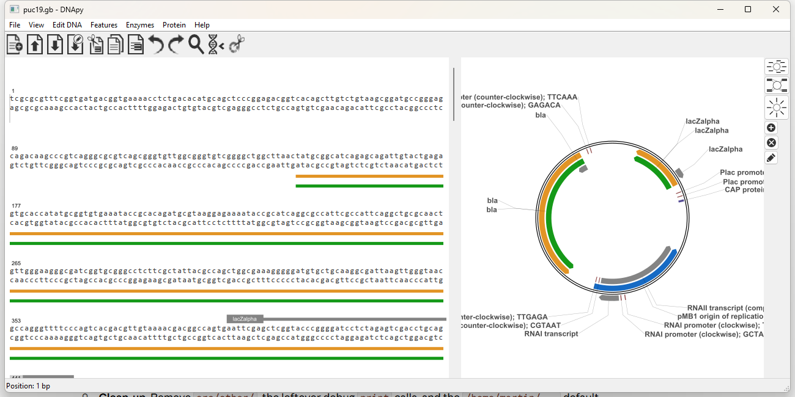

# DNApy

A free and open source desktop program for viewing and editing DNA in the GenBank format, written in Python.

DNApy shows a sequence and its complementary strand with the annotated features, next to a circular map of the plasmid. You can edit the sequence, edit the features, find and mutate positions, translate to protein, design mixed base codons and see where restriction enzymes cut.



DNApy was started by Martin Engqvist ([mengqvist/DNApy](https://github.com/mengqvist/DNApy)) for Python 2 and Linux. This repository is a revival of it for Python 3. Most of the work so far went into making it run again and covering it with tests; see [Status](#status).

## Status

- **It runs on Python 3 and is usable for viewing and editing GenBank files.** It has been developed and tried on Windows 11 with Python 3.14, wxPython 4.3.1 and pycairo 1.29. Linux and macOS have not been tried yet (the original ran on Linux).
- **Tested automatically** (246 tests): the sequence and GenBank code, restriction enzymes, codon design, settings, and the GUI with synthetic mouse, keyboard and menu events. The GUI has also been tried by hand, but not every dialog and function.
- **Not finished**: see [Known limitations](#known-limitations) and the TODO list in [OVERVIEW.md](OVERVIEW.md).

This is software under development. Keep a copy of your files; it reads and writes GenBank files, and the writer does not preserve everything that other programs put into a file.

## What it does

- Shows the sequence with its complementary strand, wrapped to the window, with a scroll bar. Features are drawn above (leading strand) and below (complement strand) the sequence, in colors by feature type.
- Shows a circular plasmid map with features, labels and restriction sites.
- Edits the sequence: type bases, delete, cut, copy and paste (also as reverse complement), upper and lower case, reverse complement of a selection, select with the mouse or with the keyboard. Features move with the sequence. Unlimited undo and redo.
- Adds, removes and edits GenBank features and their qualifiers (double click a feature, or use the feature list).
- Finds nucleotide or amino acid sequences (ambiguity codes work) and positions, and finds features by name.
- Mutates a position, by nucleotide or by amino acid (for example `A2G(GGA)`).
- Translates a selection, its reverse complement, or a feature.
- Designs mixed base codons: choose the amino acids you want and it finds the degenerate codon with the fewest off-target amino acids.
- Finds restriction sites for the enzymes of the REBASE list in `dnapy/data/emboss_e.txt`, marks the cut positions, and simulates a digest on an agarose gel preview.
- Opens and saves `.gb` files, and saves the plasmid map as a vector drawing (`.svg`) or an image (`.png`) with File > Export plasmid map.

## Requirements

- Python 3.11 or newer (the settings are read with the standard library module `tomllib`)
- [wxPython](https://wxpython.org) 4.x, for the window
- [pycairo](https://pycairo.readthedocs.io), for the drawing
- [PyPubSub](https://pypi.org/project/Pypubsub/), for messages between the panels

`pip install` (below) installs all of them. `pyperclip` is included in the repository and needs no installation. On Linux, wxPython and pycairo need some system libraries; check their installation pages.

## Installing and running

Download or clone the repository, then install it from its top level folder:

```
git clone https://github.com/MedziMatyas/DNApy.git
cd DNApy
pip install .
```

This installs the `dnapy` package with its data files and creates a `dnapy` command. Start the program with either of

```
dnapy
python -m dnapy
```

It is not published on PyPI. A virtual environment is a good place to install it into.

To run it from the folder without installing it (for development), install the requirements yourself and start it from the top level folder:

```
pip install wxPython pycairo PyPubSub
python -m dnapy
```

Use File > Open (`Ctrl+O`) to open a GenBank file. A small test file is in `tests/data/test_plasmid.gb`, and `tests/data/puc19.gb` is the pUC19 cloning vector.

Some shortcuts: `Ctrl+Z` / `Shift+Ctrl+Z` undo and redo, `Ctrl+X` / `Ctrl+C` / `Ctrl+V` cut, copy and paste (add `Shift` for the reverse complement), `Ctrl+R` reverse complement of the selection, `Ctrl+A` select all, `Ctrl+T` translate, `Ctrl+E` choose restriction enzymes, `Ctrl+D` digest.

## Configuration

The defaults are in [`dnapy/defaults/settings.toml`](dnapy/defaults/settings.toml): the size of the window, the folder where the file dialogs start, the colors, and the color of each GenBank feature type.

To change something, write only the entries you want to change into `~/.dnapy/settings.toml` (or into the file named by the environment variable `DNAPY_SETTINGS`). Everything you leave out keeps its default. For example, to make coding sequences blue and the window smaller:

```toml
[window]
size = [1100, 600]

[features.colors]
CDS = "blue"
```

The settings are checked when the program starts, and a wrong entry gives an error that says which one.

DNA ladders that you add in the digest window are saved in `~/.dnapy/dnaLadders.lst`.

## Tests

```
python -m unittest discover -s tests -t .
```

The GUI tests need wxPython and pycairo and open (and close) windows; without them they are skipped.

## Project layout

| Folder | Content |
|---|---|
| `dnapy/` | The program. `genbank.py` (GenBank reading, writing and editing), `dna.py`, `protein.py`, `enzyme.py`, `mixed_base_codons.py`, `ladders.py`, `settings.py` |
| `dnapy/gui/` | The window and its panels (wxPython and Cairo) |
| `dnapy/data/` | The restriction enzyme list, DNA ladders and the icons |
| `dnapy/defaults/` | `settings.toml` |
| `dnapy/external/` | Third party code that ships with the program (pyperclip, trace file readers, ...) |
| `docs/` | Reference text about GenBank features and qualifiers, and the picture above |
| `tests/` | The tests and test files |
| `pyproject.toml` | Packaging |

## Known limitations

- Developed on Windows only so far. It can be installed with pip from the repository, but is not published on PyPI and there is no stand-alone installer.
- The text is drawn with Cairo's basic text functions on a monospaced grid. That works for DNA, but labels have no advanced text layout, and high resolution displays have not been looked at.
- Sequences up to about 50 kb are supported, which covers plasmids, cosmids and large viral vectors. The sequence view draws the whole sequence as one image, which has a maximum size, so in a longer sequence the last part is not drawn and editing gets slow. DNApy shows a warning when you open such a file (the file itself is not changed).
- On the plasmid map in the window, long labels are cut off at the edge of the panel. The exported map (SVG or PNG) is sized to fit all labels.
- GenBank files are read and written by DNApy's own parser. Unusual files from other programs may not load, and a saved file may differ from the original (for example in the header and in how qualifiers wrap).

## Not implemented

Ideas from the original project that are not there yet: analysis of sequence traces (`.ab1`), codon optimization, fetching sequences from NCBI, primer design, PCR simulation, BLAST, ribosome binding site strength, and sequence alignment.

## More information

[OVERVIEW.md](OVERVIEW.md) describes what was done to port the program, how it is built, and what is left to do.

## License

GPL version 3 or later, see [LICENSE](LICENSE). Copyright for the original code 2014-2015 Martin Engqvist; the Python 3 port is by the contributors of this repository. Contributions in the form of improvements and new functions are welcome.
